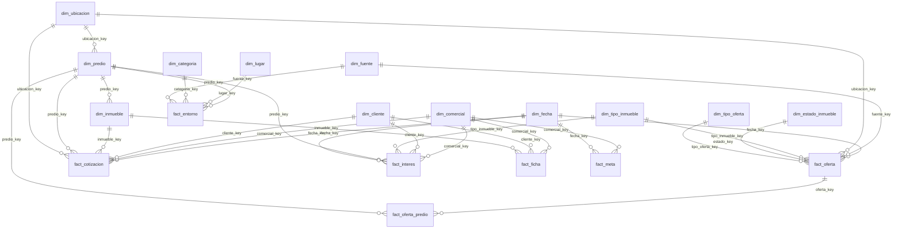

# Almacén en esquema estrella y su ETL

Archivo: `data/almacen.db` (SQLite). Esquema: `src/almacen/esquema.py` (v1.3). ETL: `src/almacen/etl.py`.
Reglas del ETL: `config/almacen.yaml`. Es lo que alimenta la **ficha del inmueble** y el **tablero comercial**.

## 1. Por qué un almacén aparte

| | Base operativa (`captura.db`) | Almacén (`almacen.db`) |
|---|---|---|
| Para qué | Guardar lo que pasa: capturas, clientes, cotizaciones, metas | Analizar: comparables, entorno, tableros |
| Forma | Tablas por proceso, una captura repite lugares y ofertas | Estrella: hechos con medidas y dimensiones conformadas |
| Quién escribe | La aplicación, en cada operación | Solo el ETL |
| Datos sucios | Se conservan todos, con su motivo | Solo lo depurado entra a los hechos; lo demás queda contado en `etl_rechazo` |
| Datos personales | Documento y nombre del cliente | Nombre, documento enmascarado y su huella SHA-256 |

La misma oferta del OIME aparece en varias capturas (122 de 6.921 en la base actual). En la operativa
está repetida; en el almacén es **un solo hecho** y un puente dice a qué predios les queda cerca.

## 2. El modelo



### Hechos

| Tabla | Una fila es… | Medidas | Lo usa |
|---|---|---|---|
| `fact_oferta` | Un anuncio u oferta de mercado, una sola vez | `area_m2`, `precio`, `precio_m2`, habitaciones, baños, parqueaderos, `completitud` | Comparables de la ficha |
| `fact_oferta_predio` | Una oferta dentro del mercado de un predio (`vinculo`: `radio` o `zona`) | `distancia_m` | Qué ofertas le aplican a cada inmueble |
| `fact_entorno` | Un lugar en el entorno de un predio | `distancia_m`, `anillo_m`, `cuenta`, `n_fuentes` | Estaciones y equipamientos de la ficha |
| `fact_cotizacion` | Una cotización (comercial + cliente + inmueble + fecha) | `cuenta`, `reusada`, `duracion_s`, `lugares`, `ofertas_radio`, `tiene_ficha` | Tablero comercial |
| `fact_interes` | Un tipo de inmueble que un cliente pidió en una cotización | `cuenta`, `es_cotizado`, `n_tipos`, `peso`, `ofertas_radio` | Demanda por tipo y por comercial |
| `fact_ficha` | Una versión de ficha generada | `n_comparables`, `mediana_m2`, `coef_variacion`, `confianza`, estaciones, equipamientos | Tablero y calidad |
| `fact_meta` | La meta de un comercial en un mes | `meta_cotizaciones`, `meta_clientes` | Avance de metas |

`fact_oferta` conserva **todas** las filas, también las duplicadas y las inválidas, con sus marcas
(`es_duplicado`, `regla_dup`, `coincide_con`, `puntaje_dup`, `motivo_invalido`, `motivo_exclusion`,
`es_valida`). El cálculo usa `es_valida = 1`; la auditoría, todo lo demás.

### Dimensiones

| Tabla | Clave natural | Qué conforma |
|---|---|---|
| `dim_fecha` | `AAAAMMDD` | Año, trimestre, mes, semana ISO, día de la semana. **Hora de Colombia**: la base operativa guarda UTC |
| `dim_fuente` | `fuente_id` | Catastro, GeoMedellín, OIME, OSM, portales y fuentes informales de la muestra, con su tipo y licencia |
| `dim_ubicacion` | `municipio\|barrio` | Barrio sin tildes ni signos (`Bomboná No.1` = `Bombona No1`), comuna, y la **zona de mercado** a la que pertenece. `revisado = 0` marca las grafías que no están en catálogo: no se adivinan |
| `dim_tipo_inmueble` | tipo | Apartamento, casa, oficina, local… y su uso |
| `dim_estado_inmueble` | estado canónico | Los tres oficiales del reto y `sin_clasificar` |
| `dim_tipo_oferta` | operación + tipo de precio | venta/arriendo × **pedido/cierre** (con `CHECK`) |
| `dim_categoria` | categoría | Taxonomía de la captura y a qué categoría oficial de la ficha equivale |
| `dim_lugar` | `fuente:capa:id` | Un lugar real, una vez; las estaciones llevan su `sistema_transporte` |
| `dim_comercial` | usuario | Nombre, rol, activo |
| `dim_cliente` | `cliente_id` | Tipo de documento, documento enmascarado, huella, quién lo registró y cuándo |
| `dim_predio` | `captura:<id>` o `reto:<id>` | El punto: dirección, CBML, coordenadas EPSG:4326 y 9377, precisión, POT, valor de referencia |
| `dim_inmueble` | `cot:<id>` o `reto:<id>` | La unidad cotizada: tipo, área, estado, y su predio |

La clave `0` de cada dimensión es el miembro "sin dato". Un hecho nunca queda huérfano: una
cotización cuya captura falló apunta al predio 0 y se sigue viendo en el tablero como fallida.

**Predio e inmueble son dos cosas.** El predio es el punto capturado (un edificio); el inmueble es la
unidad que se cotiza (un apartamento de 72 m², habitable). Dos clientes pueden cotizar apartamentos
distintos del mismo edificio: comparten predio y entorno, pero cada uno tiene su inmueble y su ficha.

### Vistas

`v_oferta`, `v_entorno`, `v_cotizacion`, `v_interes` y `v_avance_meta` ya traen los nombres de las dimensiones.
Son las que conviene leer desde DB Browser o `pandas.read_sql`.

## 3. El ETL

```
EXTRACCIÓN            TRANSFORMACIÓN                                   CARGA
captura.db (lectura)  limpieza y validez (reglas oficiales)            dimensiones por clave natural
reto_oficial/data     duplicados R1 / R2 con auditoría                 (clave sustituta estable)
(con huella SHA-256)  barrios, fechas a hora local, sistema de línea   hechos por alcance (idempotente)
                      estado canónico, predio ≠ inmueble               bitácora + controles de calidad
```

| Paso | Qué hace | Regla |
|---|---|---|
| Catálogos | Fuentes, tipos, estados, operación × tipo de precio, categorías | `fuentes.yaml`, `parametros.yaml`, `taxonomia.yaml` |
| Muestra del reto | 117 anuncios con la limpieza y la deduplicación **oficiales**, en el orden del CSV | `parametros.yaml`; módulos `ficha.limpieza` y `ficha.deduplicacion` |
| Inmuebles del reto | 11 predios e inmuebles; coordenadas dentro del área de estudio | `ficha.yaml › crs.bbox_area_estudio` |
| Capas del reto | Estaciones y equipamientos de OSM; distancia con haversine a cada predio | `ficha.yaml › entorno` |
| Captura | Predio, ofertas del radio, lugares depurados (maestros sin exclusión) y estaciones | `almacen.yaml › capturas`, `transporte` |
| Duplicados por base | Mismo aviso republicado en una base capturada (R1 y R2) | `almacen.yaml › bases_mercado.<base>.claves_duplicado` |
| Repetidos entre sitios | No se calculan aquí: los marca la depuración de anuncios, antes del ETL (R3). El ETL los recibe en `regla_dup_previa`, `puntaje_dup_previo` y `coincide_con_previo`, y los deja como duplicado del anuncio conservado, con esa regla y ese puntaje | `almacen.yaml › bases_mercado.portales.duplicados_entre_sitios` |
| Zonas | Qué predios entran a cada zona de la muestra por su barrio | `almacen.yaml › zonas_mercado` |
| Gestión | Comerciales, clientes, cotizaciones, inmuebles, fichas y metas | `reglas.yaml` |
| Calidad | Controles duros y alertas | `almacen.yaml › calidad` |

**Modos:** `completo` (todo), `captura` (una o varias capturas; es lo que corre al terminar cada
cotización), `gestion` (solo lo comercial; lo corre el tablero si algo cambió) y `reto`.

**Idempotente.** Volver a correr no duplica ni pierde: las dimensiones se actualizan por clave natural
y conservan su clave sustituta; los hechos de una captura se reemplazan completos. Si una corrida
falla, se deshace entera y queda registrada con `estado = error`.

**Capturas que no terminaron.** Una captura `en_curso` o `error` no alimenta hechos: queda en
`etl_rechazo` con `captura_sin_cerrar` o `captura_en_error`, y sus registros siguen en la base operativa.

## 4. Lo que deja cada corrida

| Tabla | Contenido |
|---|---|
| `etl_corrida` | Modo, alcance, estado (`ok`, `con_alertas`, `con_fallas`, `error`), versión y huella de configuración |
| `etl_paso` | Por entidad y alcance: **leídos = cargados + duplicados + rechazados**, y si cuadra |
| `etl_rechazo` | Todo lo que no entró a un hecho, con `motivo_exclusion` (fila a fila o agrupado) |
| `etl_ajuste` | Cada valor que la transformación cambió: antes, después y regla |
| `etl_calidad` | Resultado de cada control |
| `etl_insumo` | Archivos usados con su SHA-256 |

### Controles de calidad

Fallas (regla dura): integridad referencial · pedido y cierre separados · `precio_m2 = precio / área` ·
toda oferta válida con medidas · todo duplicado con regla, puntaje y fila de coincidencia · toda
exclusión con motivo · cotización y ficha con comercial y cliente · distancias en metros y dentro del
radio · predios dentro del área de estudio · un inmueble por cotización · conciliación.

Alertas (dato válido con una limitación que la ficha declara): ofertas históricas o sin fecha ·
bases sin precios de cierre · capturas sin cerrar · cotizaciones sin datos del inmueble o sin ficha ·
líneas de transporte sin sistema · barrios sin revisar · duplicados con identificadores distintos.

## 5. Cómo lee la ficha

`src/ficha/desde_almacen.py`:

1. `dim_inmueble` + `dim_predio` + `dim_ubicacion` → el inmueble.
2. Por cada base de `almacen.yaml › preferencia`: si aplica (por zona o por radio), toma sus ofertas de
   `v_oferta` (+ `fact_oferta_predio`) y calcula el mercado con `ficha.mercado` y `ficha.confianza`.
3. La principal es la primera que alcanza `minimo_para_preferir` comparables; las demás se reportan aparte.
4. `v_entorno` → estación más cercana, estaciones y equipamientos en el radio.
5. Norma: de la capa entregada (inmuebles del reto) o del tratamiento leído en la captura.

| Base | Vínculo | Criterio de comparables |
|---|---|---|
| `muestra_v1` (anuncios de Venture One) | Zona de mercado del barrio | Regla oficial: misma zona, mismo estado, área ±30 % |
| `portales` (anuncios vigentes de inmobiliarias) | La captura del predio | Venta, mismo tipo de inmueble, área ±30 %, sin filtro de estado. Es la base que hoy produce comparables |
| `oime` (ofertas OIME 2023) | Radio del predio | El mismo criterio, pero son de 2023: quedan fuera por vigencia y se informan como referencia histórica |

### Vigencia de los comparables

Regla de `almacen.yaml › vigencia`, solo para inmuebles de una cotización: un comparable no puede tener más de
6 meses de publicado a la fecha de la ficha. La ficha aplica la regla al leer cada base:

- Publicado antes del plazo → `publicacion_fuera_de_vigencia`. Sale de los comparables y entra a la referencia histórica.
- Sin fecha de publicación → vale la fecha en que se vio publicado (`fact_oferta.observada_en`), si la regla lo permite.
- Los 11 inmuebles del reto no llevan la regla: la muestra oficial no trae fechas y su resultado debe seguir igual.
- El paso "Depuración de anuncios" mide la vigencia al cotizar (cuántos anuncios valen por su fecha y cuántos por el
  día en que se vieron). La exclusión la sigue aplicando la ficha, con su fecha, al leer del almacén.

### La demanda: qué pidieron los clientes

`fact_interes` tiene una fila por cada tipo de inmueble que el cliente dijo buscar en una cotización.

| Pregunta | Cómo se responde |
|---|---|
| ¿Cuántas cotizaciones pidieron un tipo? | `COUNT(*)` por `tipo_inmueble` con `cuenta = 1` |
| ¿Cuántas no lo pidieron? | Cotizaciones con búsqueda registrada menos las que lo pidieron |
| ¿Qué pidió el cliente de cada comercial? | `v_interes` por `comercial` y `tipo_inmueble` |
| ¿Cuántas cotizaciones hay detrás? | `SUM(peso)`: un cliente que pide tres tipos suma 1, no 3 |
| ¿Hay oferta de lo que piden? | `ofertas_radio`: ofertas válidas de ese tipo a la vista del predio |

## 6. Consultas útiles

```sql
-- Cotizaciones por comercial y mes, con su meta
SELECT comercial_nombre, anio_mes, cotizaciones, meta_cotizaciones FROM v_avance_meta;

-- Mercado de venta por barrio (solo ofertas válidas, precio pedido)
SELECT barrio, tipo_inmueble, COUNT(*) AS n, ROUND(AVG(precio_m2)) AS promedio_m2
FROM v_oferta WHERE es_valida = 1 AND operacion = 'venta' AND tipo_precio = 'pedido'
GROUP BY barrio, tipo_inmueble HAVING n >= 5 ORDER BY n DESC;

-- Qué quedó fuera en la última corrida completa y por qué
SELECT entidad, motivo_exclusion, SUM(n) FROM etl_rechazo
WHERE corrida_id = (SELECT MAX(corrida_id) FROM etl_corrida WHERE modo = 'completo')
GROUP BY 1, 2 ORDER BY 3 DESC;

-- Demanda por tipo de inmueble y comercial
SELECT comercial_nombre, tipo_inmueble, COUNT(*) AS solicitudes, ROUND(SUM(peso), 2) AS cotizaciones
FROM v_interes WHERE cuenta = 1 GROUP BY 1, 2 ORDER BY 1, 3 DESC;

-- Equipamientos a 800 m de un predio, por categoría de la ficha
SELECT categoria_ficha, COUNT(*) FROM v_entorno
WHERE predio_nk = 'captura:<id>' AND cuenta = 1 AND en_mapa = 1 AND categoria_ficha IS NOT NULL AND distancia_m <= 800
GROUP BY 1;
```

## 7. Límites conocidos

- SQLite alcanza de sobra para el volumen actual (decenas de miles de filas por captura). Si varios
  equipos escriben a la vez o se necesitan cruces espaciales en la propia base, el paso natural es
  PostgreSQL + PostGIS; el esquema usa tipos portables.
- La deduplicación de una base capturada recorre toda la base en cada corrida. Con cientos de miles
  de ofertas convendría hacerla incremental.
- El entorno de un inmueble capturado usa la taxonomía de la captura, que no es idéntica a las
  etiquetas de OpenStreetMap del reto (AU-11).
